# How net_quota works

This page explains the whole system with diagrams, from the system call that
sets a limit to the moment a send or receive is refused and the moment the
limit ends. It is written from the code of the current version (patches 0001
to 0006 and the files in `kernel-code/new-files/`, for Linux 7.2.12).

How to read the diagrams:

- A **diamond** is a decision. The text on each arrow leaving it is the
  condition for that branch.
- A **green box** is a success return, a **red box** is an error return, a grey
  box is something that happens on the way.
- Return values are written as the kernel gives them, for example
  `-EINVAL`. User space sees `-1` and finds `EINVAL` in `errno`. The exact
  texts that the tools print are in the tables under the diagrams.
- The pages that go with this one are listed in section 10. The system call
  alone, as a reference, is in [syscall-reference.md](syscall-reference.md).

## 1. The pieces

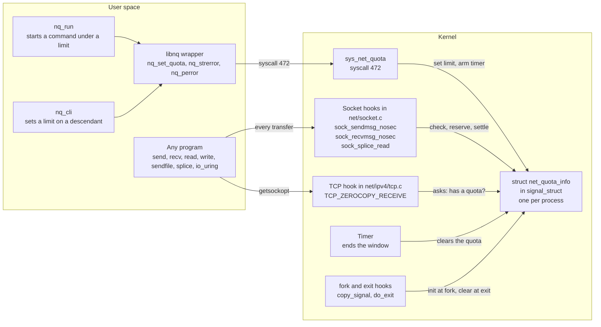

| Part | Where it is |
|---|---|
| The system call, the counting rules, the timer | `kernel-code/new-files/net_quota/net_quota.c` |
| The record (`net_quota_info`) and the state names | `kernel-code/new-files/include/linux/net_quota.h` |
| The inline fast path and the ticket | `kernel-code/new-files/include/net/net_quota.h` |
| The constants and error codes shared with user space | `kernel-code/new-files/include/uapi/linux/net_quota.h` |
| The record inside `signal_struct` | patch 0001 |
| Initialise at fork | patch 0002 |
| Clear at exit | patch 0003 |
| The socket hooks | patch 0004 |
| Build, register as syscall 472 | patch 0005 |
| Refuse `TCP_ZEROCOPY_RECEIVE` under a quota | patch 0006 |
| The wrapper and the tools | `user-code/src/`, `user-code/include/` |

## 2. The quota record and its states

The record lives in `signal_struct`, which all threads of a process share, so a
limit belongs to the **process**, never to one thread.

| Field | Meaning |
|---|---|
| `state` | `NQ_STATE_NONE` (no quota) or `NQ_STATE_ACTIVE` (limit set, timer running, bytes are charged) |
| `limit` | bytes allowed in the window, sent and received together |
| `used` | bytes charged so far, including bytes reserved by transfers in flight |
| `period_sec` | length of the window |
| `gen` | generation counter, increased every time a quota is set or cleared |
| `dead` | set when the process starts exiting; nothing can be set on it any more |
| `lock`, `timer` | a spinlock for the record, and the kernel timer that ends the window |

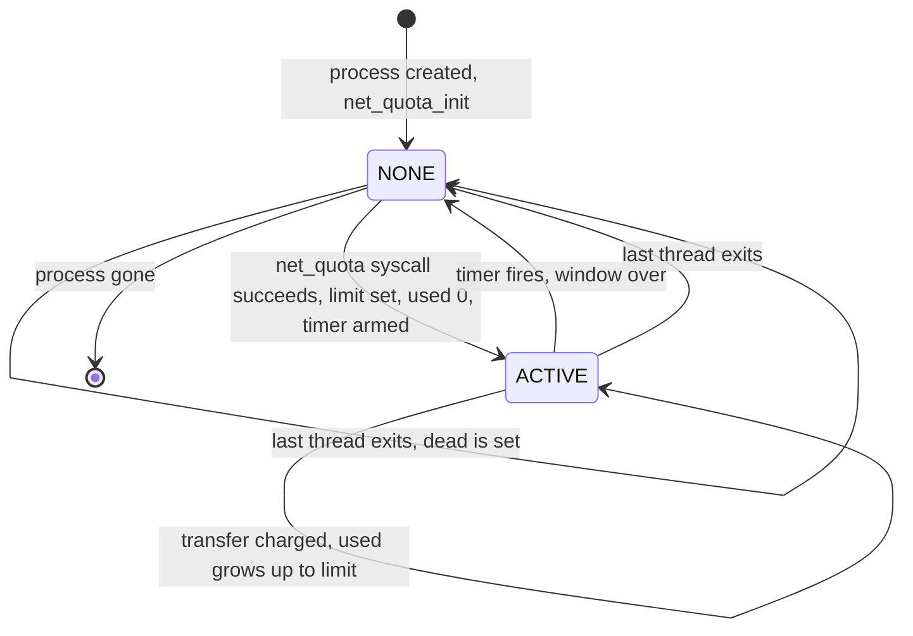

"Exhausted" is not a state: it is `state` ACTIVE with `used` equal to
`limit`. In that situation every counted send and receive fails until the
window ends, and a second `net_quota()` call on that process still returns
`-EEXIST`.

## 3. Setting a quota: the system call

`net_quota(pid, data_size, period_sec)` checks, in this order, and stops at the
first check that fails.

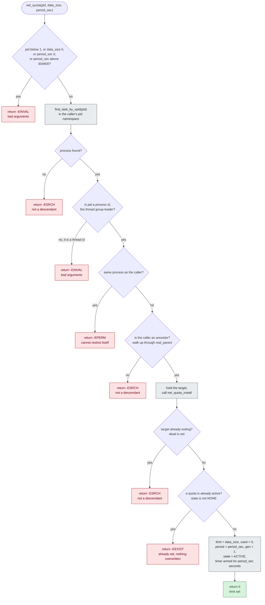

The window starts at step "timer armed", that is **when the limit is set**,
whether or not the process uses the network. When it ends the quota is revoked
(section 7).

How the caller walks up the process tree (`nq_is_descendant`). It costs
O(depth), needs no allocation, and works when the caller has several threads,
because a child's `real_parent` is the thread that forked it.

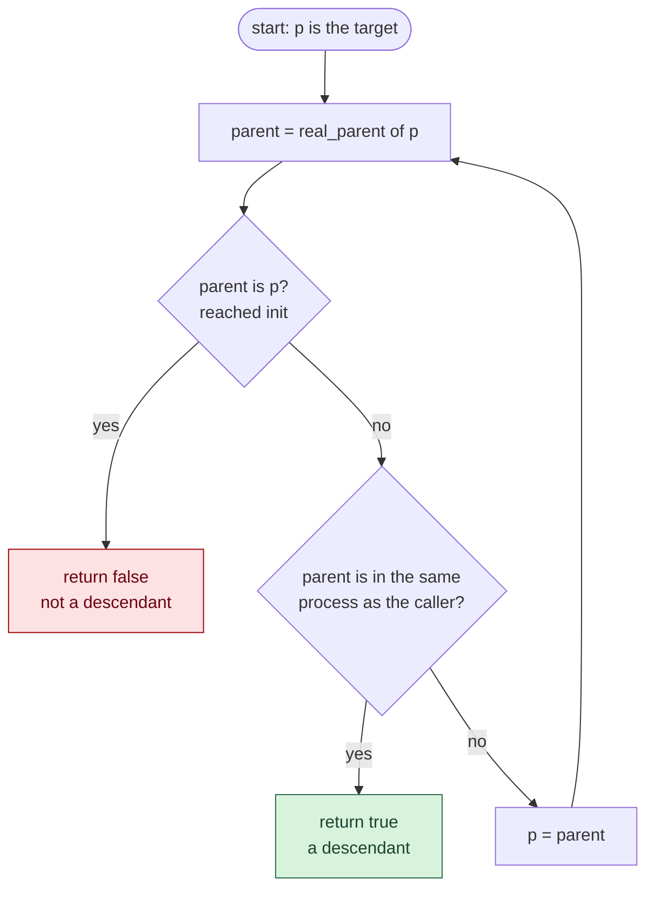

The descendant check is made once, when the limit is set. A process whose
parent died before that was handed to init (or a subreaper) and is no longer a
descendant; a quota that is already set is not affected.

Return values of the system call:

| Kernel returns | User space sees | Condition | Text printed by `nq_perror()` |
|---|---|---|---|
| `0` | `0` | limit set | `Process <pid>: network data limit of <bytes> bytes set` |
| `-EINVAL` | `-1`, `errno` = `EINVAL` | bad pid, size or period, or `pid` is a thread id | `Invalid arguments for process <pid> (limit <bytes> bytes): the pid must be a process id, and size and period must be positive and within the allowed range` |
| `-EPERM` | `-1`, `errno` = `EPERM` | the caller tried to restrict itself | `Process <pid>: a process cannot restrict itself (requested limit: <bytes> bytes)` |
| `-ESRCH` | `-1`, `errno` = `ESRCH` | no such process, not a descendant, or the target is exiting | `Process <pid> is not a descendant of the calling process (requested limit: <bytes> bytes)` |
| `-EEXIST` | `-1`, `errno` = `EEXIST` | a quota is already active on that process | `Process <pid>: a network data limit is already set, the requested <bytes> bytes were not applied` |
| `-ENOSYS` | `-1`, `errno` = `ENOSYS` | the running kernel has no syscall 472 | `The net_quota system call is not available: boot the net-quota kernel` |

## 4. User space: the wrapper and the tools

The kernel returns numbers. The texts are built in user space, from one table
of `#define`d messages (`net_quota_msgs.h`), so the codes and the texts are
written down once.

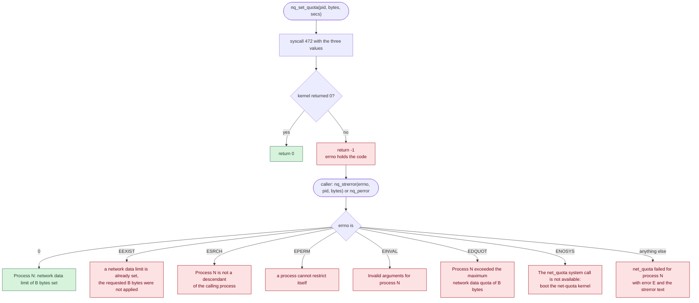

`EDQUOT` is not returned by `net_quota()`. It is the error that `send` and
`recv` report when a quota is used up; `nq_strerror` has a text for it so a
program can print it the same way.

**nq_cli** sets a limit on a descendant of itself, so by itself it is only
useful to check that the call exists. It only checks that each argument is a
plain number; a zero that passes this check is refused by the kernel with
`-EINVAL`, so it ends with exit 1 and the `EINVAL` text. Exit codes:

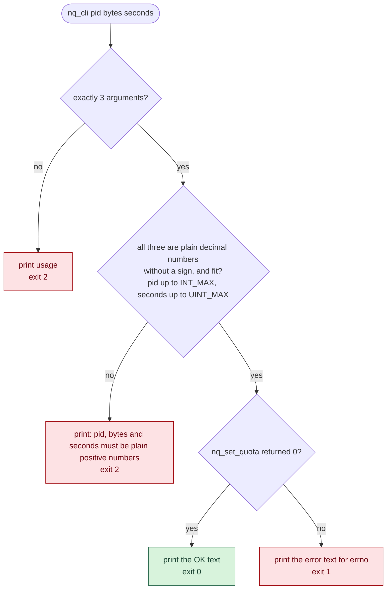

**nq_run** is the tool that restricts a real program. It starts the command as
its child, sets the limit on that child before the command starts, then lets it
go. The quota survives `exec`.

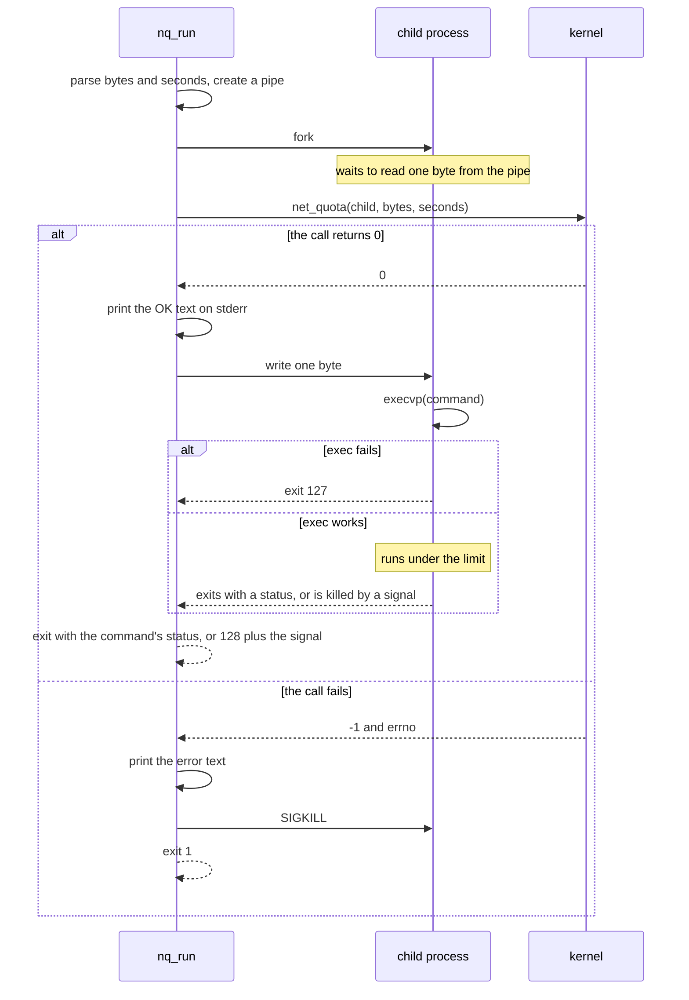

`nq_run` returns 2 for a bad command line, 1 if it cannot set up the pipe, fork
or limit, and 126 is the child's exit status if the pipe is closed before the
go byte. Children that the command forks are **not** restricted: a shell that
runs the real program as a child leaves it free; make the shell `exec` it.

## 5. Charging a transfer

### 5.1 Where the hooks sit

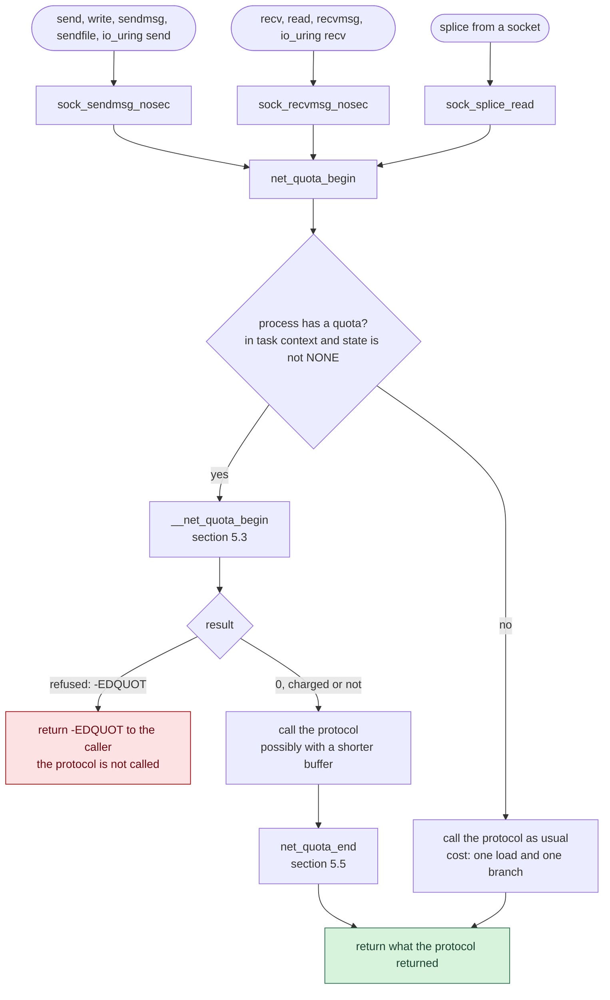

### 5.2 Which transfers are counted

Only IPv4 and IPv6 sockets whose peer is not a loopback address are counted.
`127.0.0.0/8`, `::1` and the IPv4-mapped loopback are loopback; the machine's
own non-loopback address is not.

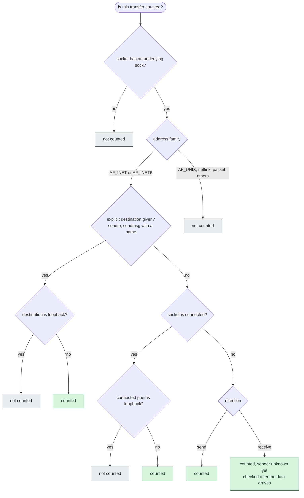

### 5.3 Check and reserve: `__net_quota_begin`

This is the heart of the system. It decides whether one send or receive may go
ahead, and how many bytes it may move. The input is the number of bytes the
caller asks for (`len`), the direction and the flags.

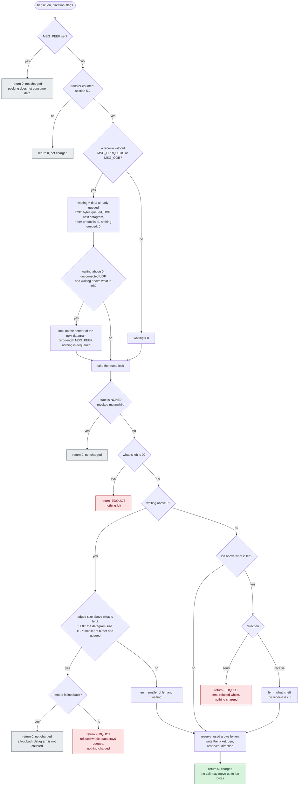

What `__net_quota_begin` returns, and what the hook does with it:

| Result | Ticket | Meaning | What happens next |
|---|---|---|---|
| `0` | not active | the transfer is not charged: `MSG_PEEK`, a socket that is not counted, a quota revoked in the meantime, or a loopback datagram | the protocol is called, `net_quota_end` does nothing |
| `0` | active, `reserved` = n | n bytes are reserved against the quota; n may be smaller than asked | the protocol is called with a buffer cut to n if needed; `net_quota_end` settles |
| `-EDQUOT` | none | nothing left, or the request does not fit | the hook returns `-EDQUOT` to the caller; the protocol is not called; nothing is charged |

The rule behind the two refusals that are not "nothing left":

- A **send** that does not fit is refused whole, on every kind of socket. A
  smaller send still works.
- A **receive** is judged by the data already waiting in the socket, not by the
  size of the buffer. See the next section.

### 5.4 The receive rule in detail

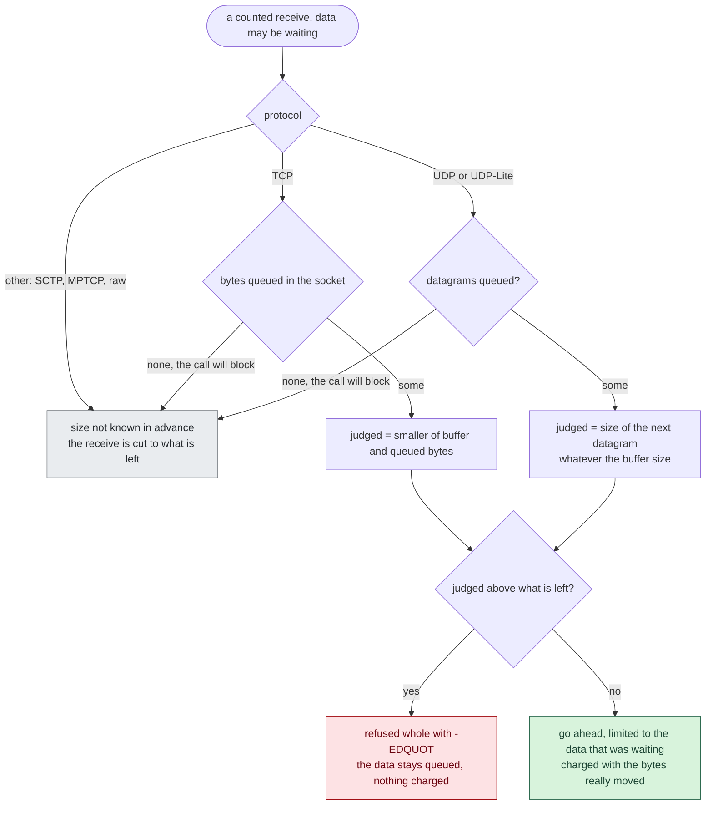

Examples (the cases that the tests check):

| Situation | What is left | Result |
|---|---|---|
| TCP, 3000 bytes queued, buffer 4096 | 2000 | judged 3000 is more than 2000: `-EDQUOT`, the 3000 bytes stay queued |
| the same, then a receive with buffer 2000 | 2000 | judged 2000: goes ahead, returns 2000, 1000 bytes stay queued |
| TCP, nothing queued yet, buffer 4096 | 1500 | the size is not known: the buffer is cut to 1500 |
| UDP, a 400-byte datagram queued, buffer 1000 | 100 | `-EDQUOT`, the datagram stays queued |
| UDP, the same datagram, buffer 50 | 100 | `-EDQUOT` too: the datagram is judged, not the buffer |
| unconnected UDP, 400-byte datagram from a loopback sender | 100 | goes ahead, not charged: loopback is not counted |
| any counted receive | 0 | `-EDQUOT` |

Two consequences: a UDP datagram that is larger than what is left stays at the
head of the queue and every later receive is refused until the window ends; and
a program that reads a TCP stream with a large buffer gets `EDQUOT` as soon as
that buffer is larger than what is left, and works again with a smaller one.

### 5.5 Settle: `__net_quota_end`

After the protocol has moved some bytes, the ticket is settled: what was
reserved but not moved is given back.

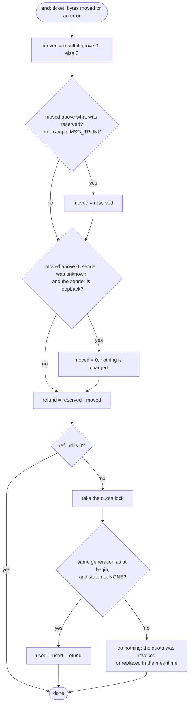

### 5.6 What the program sees

| Situation | `send` / `write` | `recv` / `read` |
|---|---|---|
| process has no quota, or the transfer is not counted | whatever the protocol returns | whatever the protocol returns |
| goes ahead | bytes sent | bytes received |
| nothing left | `-1`, `errno` = `EDQUOT` ("Disk quota exceeded") | `-1`, `errno` = `EDQUOT` |
| does not fit | `-1`, `EDQUOT`, nothing sent | `-1`, `EDQUOT`, data stays queued (see 5.4) |
| the limit ends (timer) | works again, no limit | works again, no limit |

A program that knows nothing about quotas just sees an ordinary error. `dd`,
for example, stops with `dd: error writing 'standard output': Disk quota
exceeded`.

## 6. Which calls reach the hooks

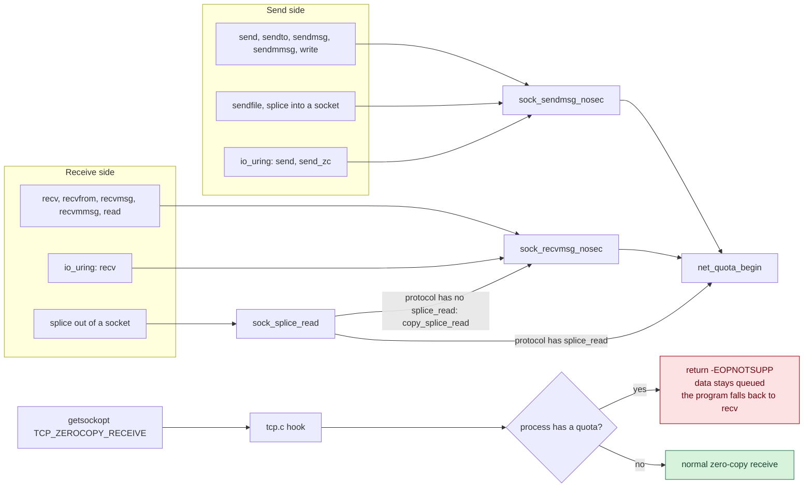

`TCP_ZEROCOPY_RECEIVE` reads data straight from the receive queue and never
passes through `sock_recvmsg()`, so on the first hardware run it was not
counted at all. Patch 0006 closes that by refusing the option for a process
that has a quota. Processes without a quota can still use it.

What each path was tested with (`user-code/tests`):

| Path | Test |
|---|---|
| `send`, `recv`, the limit, expiry | `test_basic` |
| `sendmsg`, `recvmsg`, `sendmmsg`, `recvmmsg`, `sendfile`, `splice` both ways, `MSG_PEEK`, non-blocking, zero-length send, TCP receive rule, IPv6 | `test_calls` |
| UDP, send and receive rule | `test_udp` |
| io_uring send, receive, zero-copy send, oversized send | `test_uring` |
| `TCP_ZEROCOPY_RECEIVE` | `test_zerocopy` |
| threads sharing one quota | `test_threads` |
| loopback and Unix sockets not counted | `test_loopback` |
| a real program stopped at the limit | `test_realprog.sh` |

Not tested: io_uring multishot receive with provided buffers, and io_uring
zero-copy receive.

## 7. When a quota ends

A quota ends in three ways: the timer fires, the process exits, and (not a way
to end it, but a way not to have it) a child is created.

### 7.1 The window ends

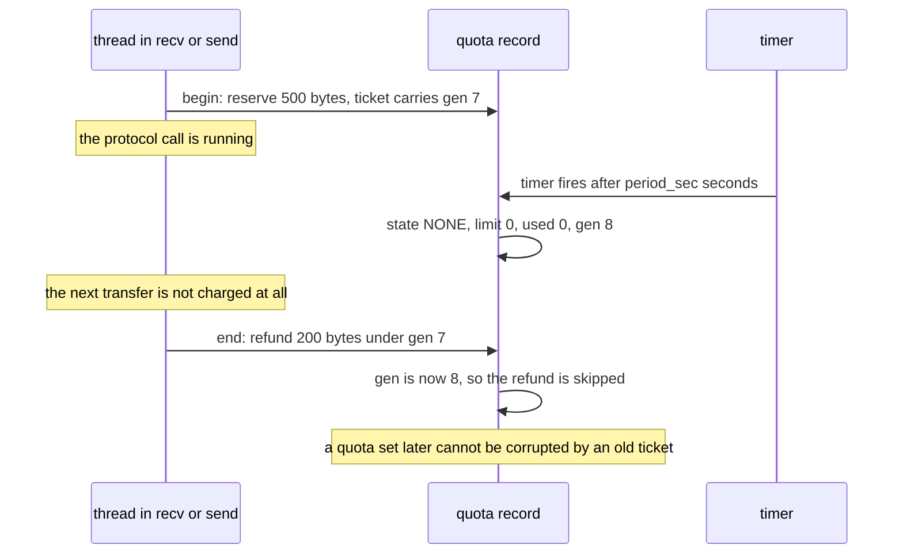

After the timer the process is unrestricted until an ancestor sets a new quota,
which starts a new window with a counter from zero. Nothing is renewed
automatically.

### 7.2 The process exits

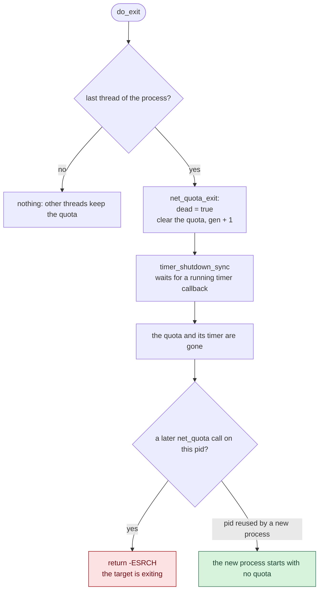

`dead` is set even for a process that never had a quota. Otherwise a quota
installed during the exit would arm a timer that nobody stops before the
`signal_struct` is freed.

### 7.3 A child is created: nothing is inherited

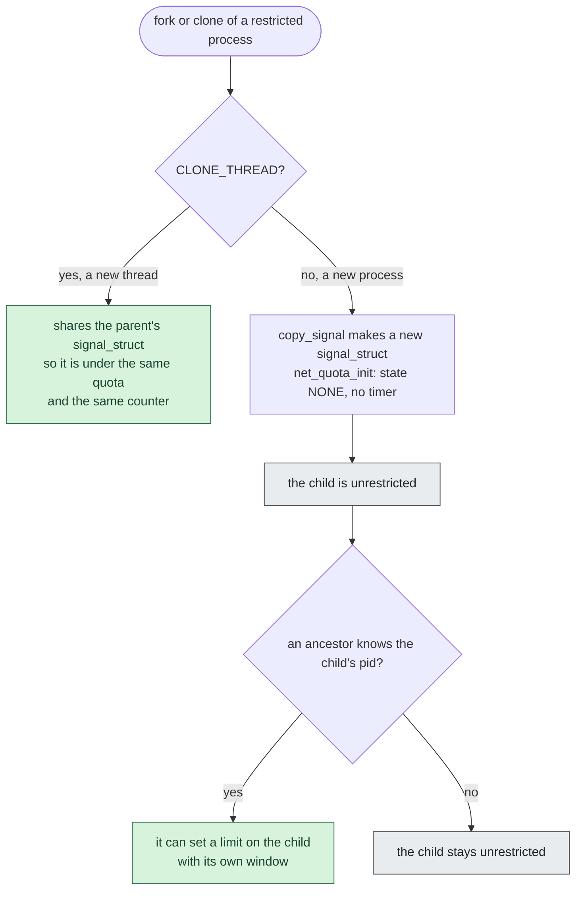

This is the professor's rule (a child starts with no quota), and it is
intended: a restricted process can fork and do its network work in the child.
`exec` keeps the quota, because it keeps the `signal_struct`; that is why
`nq_run` can set the limit on the child before the command starts.

## 8. Concurrency

All threads of a process share one record, so the record is protected by a
spinlock. The rules:

- The lookups that can sleep (`SIOCINQ`, which may take the socket lock, and the
  sender lookup) run **before** the quota lock is taken.
- The decision and the reservation are made under the lock, in one step, so
  two threads cannot both use the last bytes.
- The bytes are reserved before the transfer and given back after it, so a
  transfer that moves less than it reserved does not eat the quota.
- The timer callback and `net_quota_exit` take the same lock; the exit path
  waits for a running callback.

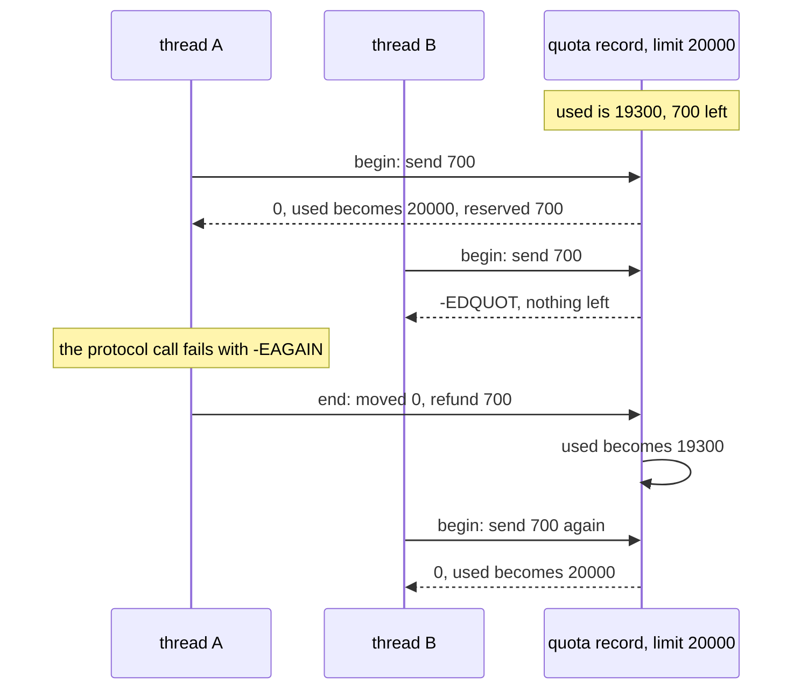

`test_threads` shows the result: four threads sending blocks of 700 bytes
against a limit of 20000 together move 19600 bytes, 28 whole blocks, and every
thread ends with `EDQUOT`.

## 9. Worked examples

### 9.1 A real program under a limit

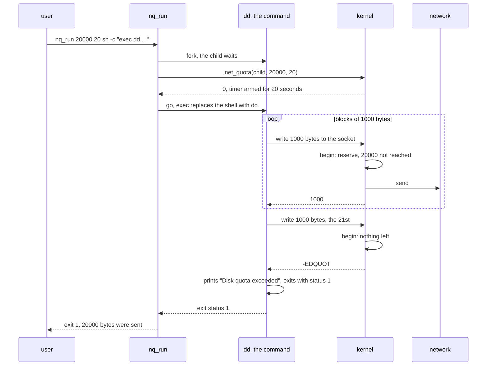

### 9.2 One quota, step by step

Limit 10000 bytes, window 4 seconds, against an echo server. This is the
sequence of `test_basic`.

| Step | Call | Left before | Result | `used` after |
|---|---|---|---|---|
| 1 | send 3000 | 10000 | 3000 | 3000 |
| 2 | recv, 3000 bytes waiting | 7000 | 3000 | 6000 |
| 3 | send 8000 | 4000 | `-EDQUOT`, does not fit, nothing charged | 6000 |
| 4 | send 4000 | 4000 | 4000 | 10000 |
| 5 | send 100 | 0 | `-EDQUOT`, nothing left | 10000 |
| 6 | recv | 0 | `-EDQUOT`, nothing left | 10000 |
| 7 | wait for the timer | | quota revoked | state NONE |
| 8 | send 1000, recv 5000 | no limit | 1000, 5000 | not counted |

Steps 1 and 2 show that sent and received bytes share one counter. Step 3
shows that an oversized send is refused whole and costs nothing, so step 4 can
still use the exact remainder. Steps 5 and 6 show that both directions stop at
the limit. Steps 7 and 8 show that the timer lifts the limit by itself.

## 10. Related pages

| Page | What it covers |
|---|---|
| [syscall-reference.md](syscall-reference.md) | the system call as a reference: signature, arguments, return values, rules, examples |
| [handoff.md](handoff.md) | what exists, what is proven, what to do next |
| [setup-and-build.md](setup-and-build.md) | building and booting the kernel, and updating an existing build |
| [../user-code/docs/design.md](../user-code/docs/design.md) | behaviour rules, decision log, known limitations |
| [gap/README.md](gap/README.md) | open gaps and the record of the professor's third change |
| [removing-net-quota.md](removing-net-quota.md) | taking the system call out of the kernel source |
| [removing-custom-kernel.md](removing-custom-kernel.md) | removing the installed custom kernel from the machine |
