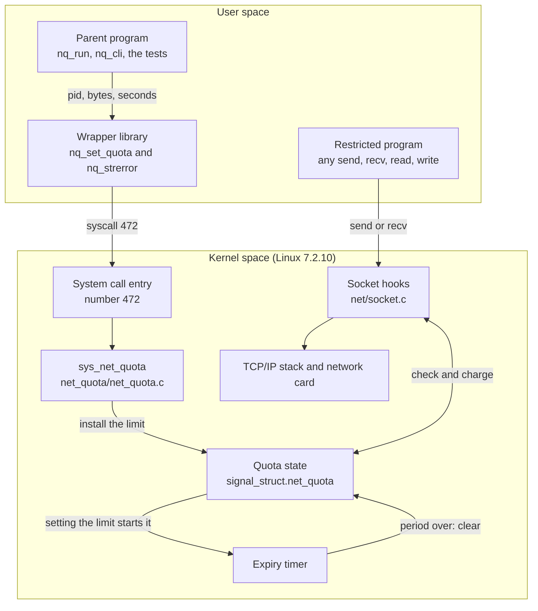
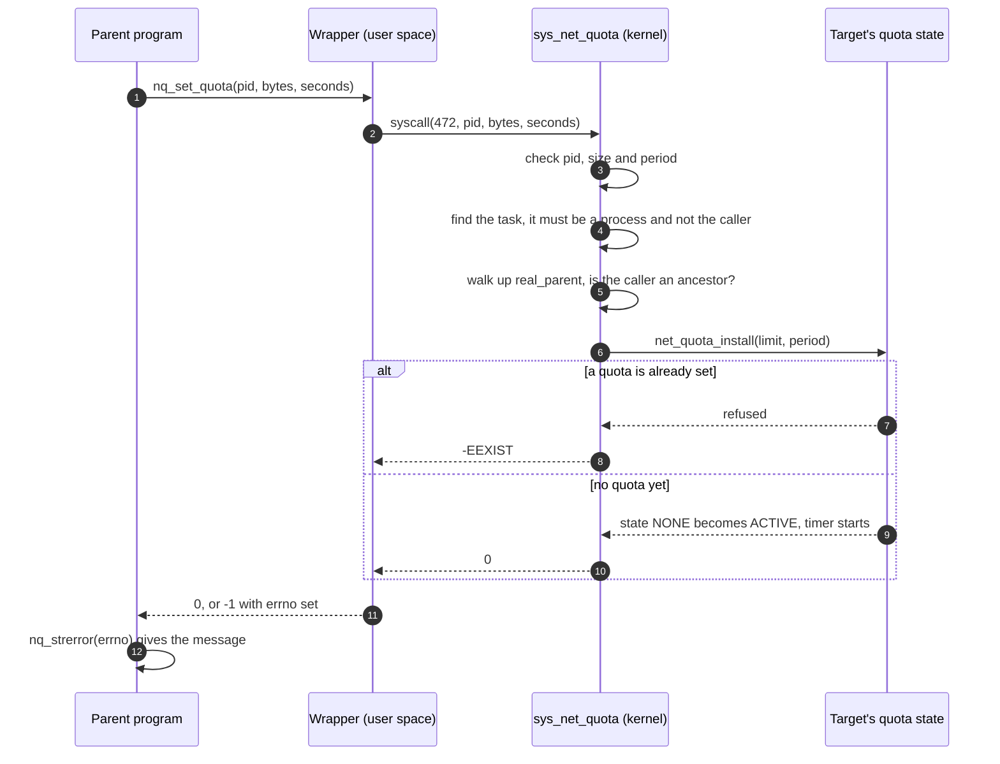
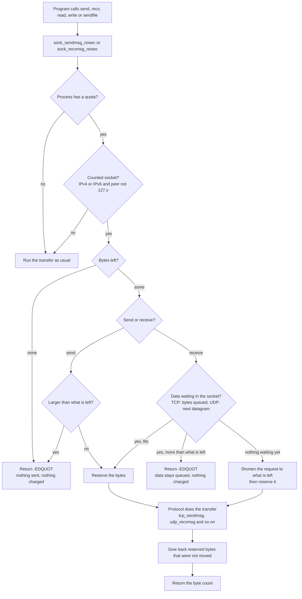
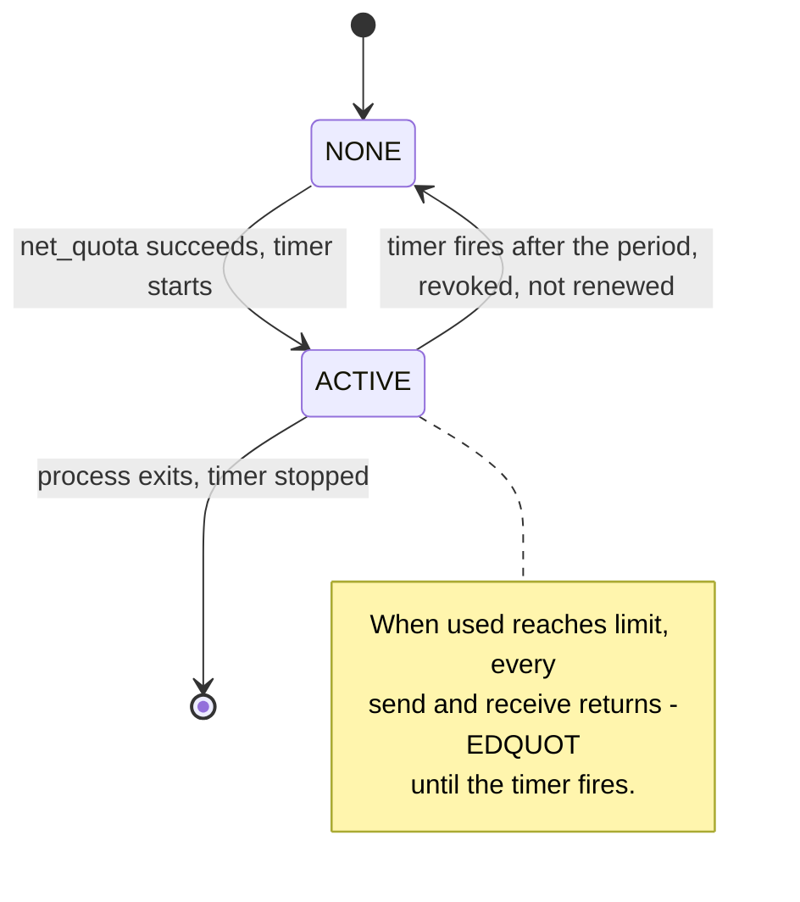
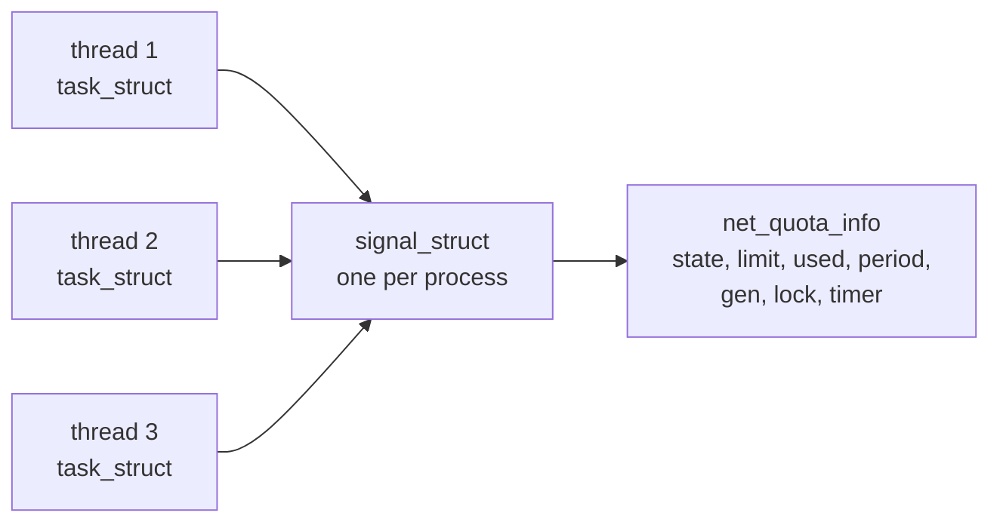
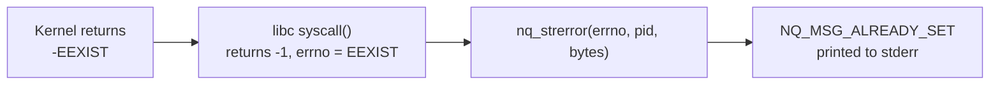

# How net_quota works

This page follows the data through the system: what goes in, what each layer
does with it, and what comes out. It has three flows (setting a quota, a
transfer under a quota, and the life of a quota), then the data structure,
how an error number becomes a message, and two worked examples.

The diagrams are Mermaid, which GitHub draws directly in the page. For the
decisions behind the behaviour and the known limitations, see
[user-code/docs/design.md](../user-code/docs/design.md).

## In one paragraph

A parent process calls `net_quota(pid, bytes, seconds)` to put a limit on one
of its descendants. The kernel stores the limit in that process. From then on,
every network send and receive of the process passes through a check in the
kernel that counts the payload bytes and refuses the call once the limit is
reached. A kernel timer lifts the limit when the period is over.

## 1. The big picture



Two separate paths meet in the quota state:

- **Setup path** (left side, runs once): the parent writes the limit.
- **Enforcement path** (right side, runs on every transfer): the restricted
  program reads and updates the counter.

The parent and the restricted program are different processes. The only thing
they share is the quota state inside the kernel.

## 2. Flow one: setting a quota



What goes in and what comes out at each step:

| Step | Layer | Input | Does | Output |
|---|---|---|---|---|
| 1 | Parent program | pid, bytes, seconds typed or passed by the caller | calls the wrapper | the wrapper's result |
| 2 | Wrapper `nq_set_quota()` in `user-code/src/net_quota.c` | the three numbers | `syscall(472, ...)` through libc | 0, or -1 and `errno` |
| 3 | Kernel entry | system call number 472 and three register values | the CPU switches to kernel mode; the number selects `sys_net_quota` in `syscall_64.tbl` | calls `SYSCALL_DEFINE3(net_quota, ...)` |
| 4 | Checks in `net_quota/net_quota.c` | pid, size, period | rejects bad values, a thread id, the caller itself, a non-descendant | `-EINVAL`, `-EPERM`, `-ESRCH` on failure |
| 5 | `net_quota_install()` | limit and period | under a lock: if the state is NONE, store the limit, set state ACTIVE and start the timer for the full period | 0, or `-EEXIST` |
| 6 | Back in user space | the kernel's negative number | libc turns `-N` into return value -1 and `errno = N` | the wrapper returns it |
| 7 | `nq_strerror()` | `errno`, pid, bytes | picks the matching `NQ_MSG_*` text | a readable message on stderr |

The call changes nothing except the state of the target. The timer starts
here, in the same moment the limit is set: the window does not wait for the
target's first network use, and it ends `seconds` later whether or not the
target has used the network by then.

## 3. Flow two: a transfer under a quota

This runs inside the kernel every time the restricted process sends or
receives, whatever call it used (`send`, `sendto`, `sendmsg`, `write`,
`recv`, `read`, `sendfile`, `splice`, io_uring).



The same flow in words, with the data that moves:

1. **Input:** the program's buffer and length (`len`) from user space.
2. **Quick exit:** a process without a quota costs one load and one branch
   (`net_quota_active()`); the rest is skipped.
3. **Which traffic counts:** only IPv4/IPv6 sockets whose peer is not a
   loopback address. Unix sockets and `127.x` traffic are ignored.
4. **Reserve before moving:** the allowed number of bytes is added to `used`
   up front, so two threads cannot both slip past the limit.
5. **Oversized request:** if `len` is more than what is left, a send is
   refused whole with `EDQUOT` (TCP and UDP alike): nothing is sent and
   nothing is charged. A receive is judged by the data already waiting in the
   socket (the protocol's `SIOCINQ`): for UDP the size of the next datagram, for
   TCP the bytes this call would take (the smaller of the buffer and the bytes
   queued). If that is more than what is left, the receive is refused whole
   with `EDQUOT`, nothing is charged and the data stays queued. If it fits, the
   call is limited to the data that was waiting. If nothing is waiting yet (the
   call is about to block), the size is not known, and the request is shortened
   (`iov_iter_truncate`) to what is left instead. On an unconnected UDP socket
   the sender of a datagram that is about to be refused is looked up first with
   a zero-length `MSG_PEEK`, because a datagram from a loopback sender is not
   counted.
6. **After the transfer:** bytes that were reserved but not moved are given
   back. A receive from a loopback sender on an unconnected socket is not
   charged.
7. **Output:** the number of bytes moved, or `-1` with `errno = EDQUOT` when
   nothing is left.

Receive-side `splice` calls the protocol directly, so it has its own hook in
`sock_splice_read()`.

## 4. Flow three: the life of a quota



| Event | Where in the kernel | What happens |
|---|---|---|
| `net_quota()` succeeds | `net_quota_install()` | NONE becomes ACTIVE; limit and period stored; `mod_timer()` starts the period |
| Period ends | `nq_timer_fn()` in softirq | quota cleared back to NONE and `used` forgotten; nothing is renewed. An ancestor may set a new quota afterwards, which starts a fresh window and a fresh counter |
| `fork()` of a restricted process | `copy_signal()` in `kernel/fork.c` | the child starts with an empty quota (state NONE): no limit, no timer. Nothing is passed on from the parent |
| Last thread exits | `do_exit()` in `kernel/exit.c` | timer stopped, quota cleared; a reused PID starts clean |
| Second `net_quota()` call | `net_quota_install()` | refused with `-EEXIST`; nothing is changed |

Threads and `fork()` differ on purpose. Threads of one process share the
quota. A new child process starts without any quota, so a restricted process
that forks can do its network traffic through the child without a limit (listed
in the known limitations). An ancestor that knows the child's pid can still set
a quota on it with a call of its own.

## 5. Where the quota lives



| Field | Meaning |
|---|---|
| `state` | NONE or ACTIVE; read without the lock on the fast path |
| `dead` | set when the process exits, so a late `net_quota()` call cannot start a timer that nobody would stop |
| `limit` | payload bytes allowed, sent plus received |
| `used` | bytes charged so far, including transfers still in flight |
| `period_sec` | length of the window in seconds |
| `gen` | bumped on every install and revoke, so a transfer that started under an old quota never touches a newer one |
| `lock` | spinlock taken with `spin_lock_bh()` because the timer runs in softirq |
| `timer` | revokes the quota when the window ends |

## 6. From a kernel error to a message

The kernel never builds text. It returns a number, and user space turns it
into a message.



| Kernel returns | `errno` | Constant | Message (start) |
|---|---|---|---|
| 0 | 0 | `NQ_OK` | "network data limit of N bytes set" |
| `-EINVAL` | EINVAL | `NQ_E_BAD_ARGS` | "Invalid arguments for process" |
| `-EPERM` | EPERM | `NQ_E_SELF_TARGET` | "a process cannot restrict itself" |
| `-ESRCH` | ESRCH | `NQ_E_NOT_DESCENDANT` | "is not a descendant of the calling process" |
| `-EEXIST` | EEXIST | `NQ_E_ALREADY_SET` | "a network data limit is already set" |
| `-EDQUOT` from send or recv | EDQUOT | `NQ_E_QUOTA_EXCEEDED` | "exceeded the maximum network data quota of N bytes" |
| `-ENOSYS` (kernel lacks the call) | ENOSYS | none | "The net_quota system call is not available" |

The codes are `#define`d once, in `kernel-code/new-files/include/uapi/linux/net_quota.h`,
and the message texts once, in `user-code/include/net_quota_msgs.h`.

A restricted program that knows nothing about quotas only sees the standard
`EDQUOT` text, "Disk quota exceeded". The longer message comes from programs
that call `nq_perror()`, such as the tests.

## 7. Worked example: the counter step by step

`test_basic` with a limit of 10000 bytes and a period of 4 seconds:

| Step | Call | Asked for | Allowed | Returned | `used` after |
|---|---|---|---|---|---|
| 1 | send | 3000 | 3000 | 3000 | 3000 |
| 2 | recv (the echo) | 3000 | 3000 | 3000 | 6000 |
| 3 | send | 8000 | 0 (does not fit) | -1, EDQUOT | 6000 |
| 4 | send | 4000 | 4000 | 4000 | 10000 |
| 5 | send | 100 | 0 | -1, EDQUOT | 10000 |
| 6 | recv | 100 | 0 | -1, EDQUOT | 10000 |
| 7 | wait 6 s | | | | timer fired, quota gone |
| 8 | send 1000, recv 5000 | | no limit | 1000, 5000 | not counted |

Sent and received bytes share the counter (steps 1 and 2), a send that does
not fit is refused whole and costs nothing (step 3), so the exact remainder
can still be used (step 4), both directions stop at the limit (steps 5 and 6),
and the timer lifts the limit by itself (steps 7 and 8).

## 8. Worked example: a real program

```bash
./build/nq_run 20000 20 bash -c \
  'exec 3<>/dev/tcp/<server-ip>/5001; dd if=/dev/zero bs=1000 count=60 >&3'
```

| Where | What happens |
|---|---|
| `nq_run` (user space) | forks a child that waits, calls `nq_set_quota(child, 20000, 20)`, prints "limit of 20000 bytes set", then lets the child `exec` bash |
| Kernel | the quota is stored with state ACTIVE and the 20-second timer starts; it survives `exec` because it belongs to the process |
| `dd` (user space) | writes 1000-byte blocks to the socket |
| Kernel, first write | 1000 bytes reserved and sent (the 20 seconds have been running since the limit was set) |
| Kernel, writes 2 to 20 | each is charged; `used` reaches 20000 |
| Kernel, write 21 | nothing left: returns `-EDQUOT` |
| `dd` (user space) | prints "Disk quota exceeded" and "20000 bytes copied", then exits with an error |

## 9. Which file does what

| Role | File |
|---|---|
| Return codes shared by kernel and user space | `kernel-code/new-files/include/uapi/linux/net_quota.h` |
| The system call, descendant check, timer, socket hook logic | `kernel-code/new-files/net_quota/net_quota.c` |
| Quota struct and lifecycle functions | `kernel-code/new-files/include/linux/net_quota.h` |
| Inline fast path for send, receive, splice | `kernel-code/new-files/include/net/net_quota.h` |
| Quota field in the process | `kernel-code/patches/0001-*` (`include/linux/sched/signal.h`) |
| Set up at fork, nothing inherited | `kernel-code/patches/0002-*` (`kernel/fork.c`): one `#include` and one `net_quota_init()` call in `copy_signal()` |
| Clear at exit | `kernel-code/patches/0003-*` (`kernel/exit.c`) |
| Hooks on send and receive | `kernel-code/patches/0004-*` (`net/socket.c`) |
| Build and register as syscall 472 | `kernel-code/patches/0005-*` (`Kbuild`, `syscall_64.tbl`, `syscalls.h`) |
| Refuse `TCP_ZEROCOPY_RECEIVE` under a quota | `kernel-code/patches/0006-*` (`net/ipv4/tcp.c`) |
| Wrapper and messages | `user-code/src/net_quota.c`, `user-code/include/net_quota_msgs.h` |
| Command-line tools | `user-code/src/nq_cli.c`, `nq_run.c`, `nq_demo.c` |
| Tests | `user-code/tests/` |

## 10. Related pages

| Page | What it covers |
|---|---|
| [handoff.md](handoff.md) | what exists, what is proven, what to do next |
| [setup-and-build.md](setup-and-build.md) | building and booting the kernel, and updating an existing build |
| [../user-code/docs/design.md](../user-code/docs/design.md) | behaviour rules, decision log, known limitations |
| [gap/README.md](gap/README.md) | open gaps and the pending professor change |
| [removing-net-quota.md](removing-net-quota.md) | taking the system call out of the kernel source |
| [removing-custom-kernel.md](removing-custom-kernel.md) | removing the installed custom kernel from the machine |

## An auto-generated diagram for comparison

[GitDiagram](https://github.com/ahmedkhaleel2004/gitdiagram) draws an
architecture diagram of any public repository: replace `hub` with `diagram`
in the repository URL (`gitdiagram.com/Dhruv0306/net-quota-syscall`). It works
from the file layout, so it shows which parts exist and how they connect. The
diagrams above show what it cannot: the path a byte takes inside the kernel,
the timer, and the quota's life cycle.
