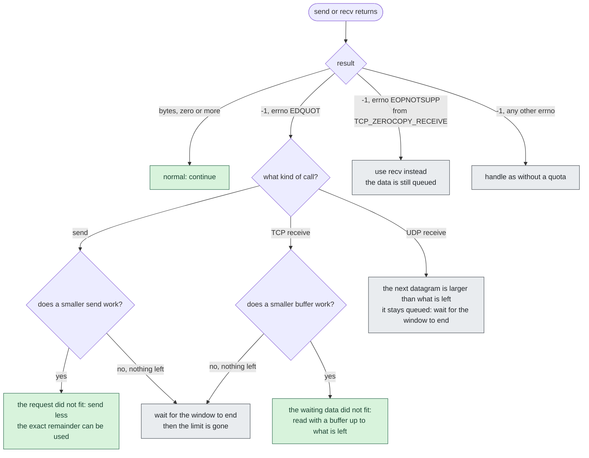

# net_quota: system call reference

The current version of the system call, for Linux 7.2.12 with patches 0001 to
0006 and the files in `kernel-code/new-files/`. How it works inside, with
diagrams, is in [how-it-works.md](how-it-works.md).

## 1. Identity

| | |
|---|---|
| Name | `net_quota` |
| Number | **472** on x86_64, `common` entry in `arch/x86/entry/syscalls/syscall_64.tbl`: `472 common net_quota sys_net_quota` |
| Architectures | x86_64 only: no 32-bit or compat entry |
| Kernel | Linux 7.2.12 (also applies on 7.2.10), `CONFIG_NET`; IPv6 traffic is counted when `CONFIG_IPV6` is set |
| Privilege | none: no capability is needed. The only condition is that the target is a descendant of the caller |
| Constants | `include/uapi/linux/net_quota.h`: `NQ_OK`, `NQ_E_BAD_ARGS`, `NQ_E_SELF_TARGET`, `NQ_E_NOT_DESCENDANT`, `NQ_E_ALREADY_SET`, `NQ_E_QUOTA_EXCEEDED`, `NQ_MAX_PERIOD_SEC` |

## 2. Synopsis

Kernel prototype (`net_quota/net_quota_syscall.h`):

```c
asmlinkage long sys_net_quota(pid_t pid, u64 data_size, unsigned int period_sec);
```

From user space, with the raw system call or with the helpers in `user-code/`:

```c
#include <linux/net_quota.h>          /* NQ_* constants */
#include "net_quota_user.h"           /* nq_set_quota, nq_strerror, nq_perror */

/* 0 on success, -1 with errno set on failure */
int nq_set_quota(pid_t pid, uint64_t data_size, unsigned int period_sec);

/* build the message for an errno, or print it on stderr */
const char *nq_strerror(int err, pid_t pid, uint64_t bytes, char *buf, size_t buflen);
void nq_perror(int err, pid_t pid, uint64_t bytes);
```

`net_quota_wrapper.h` also has a macro, `net_quota(pid, bytes, secs)`, that is
the raw `syscall(472, ...)` and returns its result unchanged.

## 3. Description

`net_quota()` limits how many payload bytes the process `pid` may move over the
network during the next `period_sec` seconds. Bytes sent and bytes received
are added on one counter. When the counter reaches `data_size`, further sends
and receives of that process fail with `EDQUOT`. When the period ends the limit
is lifted by itself and the process is unrestricted again.

A limit can only be put on a **descendant** of the caller: a child, a
grandchild, and so on.

### Arguments

| Argument | Type | Allowed values | Meaning |
|---|---|---|---|
| `pid` | `pid_t` | above 0; a **process** id (not a thread id) of a descendant of the caller, in the caller's pid namespace; not the caller itself | the process to restrict |
| `data_size` | `u64` | above 0 | bytes allowed in the window, sent and received together |
| `period_sec` | `unsigned int` | 1 to 604800 (`NQ_MAX_PERIOD_SEC`, 7 days) | length of the window in seconds |

### Return value

On success `0`. On failure the kernel returns a negative error; user space sees
`-1` from `syscall()` and the positive value in `errno`.

| Error | Constant | Condition |
|---|---|---|
| `EINVAL` | `NQ_E_BAD_ARGS` | `pid` is 0 or negative, `data_size` is 0, `period_sec` is 0 or above 604800, or `pid` is a thread id |
| `EPERM` | `NQ_E_SELF_TARGET` | `pid` is the calling process |
| `ESRCH` | `NQ_E_NOT_DESCENDANT` | no such process in the caller's pid namespace, or it is not a descendant of the caller, or it is already exiting |
| `EEXIST` | `NQ_E_ALREADY_SET` | a limit is already active on that process; nothing is overwritten |
| `ENOSYS` | | the running kernel has no syscall 472 |

The checks are made in this order and the first that fails decides the error
(the full flow is in section 3 of [how-it-works.md](how-it-works.md)):

1. arguments out of range: `EINVAL`
2. process not found: `ESRCH`
3. `pid` is a thread, not a process: `EINVAL`
4. `pid` is the caller: `EPERM`
5. not a descendant: `ESRCH`
6. target exiting: `ESRCH`
7. a limit already active: `EEXIST`
8. otherwise the limit is set and the timer is armed: `0`

Texts printed by the helpers (`nq_perror`, `nq_strerror`):

| errno | Text |
|---|---|
| 0 | `Process <pid>: network data limit of <bytes> bytes set` |
| `EEXIST` | `Process <pid>: a network data limit is already set, the requested <bytes> bytes were not applied` |
| `ESRCH` | `Process <pid> is not a descendant of the calling process (requested limit: <bytes> bytes)` |
| `EPERM` | `Process <pid>: a process cannot restrict itself (requested limit: <bytes> bytes)` |
| `EINVAL` | `Invalid arguments for process <pid> (limit <bytes> bytes): the pid must be a process id, and size and period must be positive and within the allowed range` |
| `EDQUOT` | `Process <pid> exceeded the maximum network data quota of <bytes> bytes` |
| `ENOSYS` | `The net_quota system call is not available: boot the net-quota kernel` |
| anything else | `net_quota failed for process <pid> with error <errno> (<strerror text>)` |

## 4. Rules

**What is counted**

- Payload bytes only, sent and received, on one combined counter.
- Only IPv4 and IPv6 sockets whose peer is not a loopback address (`127.0.0.0/8`,
  `::1`, IPv4-mapped loopback). Unix sockets, netlink, packet sockets and
  loopback traffic cost nothing. The machine's own non-loopback address **is**
  counted.
- `MSG_PEEK` is not counted (it does not consume data).
- Every call that goes through the socket layer: `send`, `sendto`, `sendmsg`,
  `sendmmsg`, `write`, `recv`, `recvfrom`, `recvmsg`, `recvmmsg`, `read`,
  `sendfile`, `splice` both ways, and io_uring send, receive and zero-copy send.
- `getsockopt(TCP_ZEROCOPY_RECEIVE)` would bypass the counting, so it fails with
  `EOPNOTSUPP` for a process under a limit. The data stays queued and `recv()`
  reads it.

**When a transfer is refused**

- Nothing left: every counted send and receive fails with `EDQUOT`.
- A **send** larger than what is left is refused whole with `EDQUOT`. Nothing is
  sent and nothing is charged; a smaller send still works.
- A **receive** is judged by the data already waiting in the socket (UDP: the
  next datagram, whatever the buffer; TCP: the smaller of the buffer and the
  queued bytes). If that is more than what is left, the receive is refused whole
  with `EDQUOT` and the data stays queued. Where nothing is waiting yet, or the
  protocol is not TCP or UDP, the size is not known and the receive is cut to
  what is left.
- A refusal costs nothing.

**The window**

- It starts when the limit is set, not at the first transfer. A limit on a
  process that never uses the network also ends after `period_sec`.
- When it ends the limit is revoked and the counter is forgotten. Nothing is
  renewed. An ancestor may set a new limit afterwards, with a new window and a
  counter from zero.
- A limit that is already active is never overwritten (`EEXIST`), even when the
  counter has reached the limit.

**Processes and threads**

- The limit belongs to the process. All threads share one counter.
- A child created by `fork()` starts **without** a limit. A restricted process
  can therefore do its network work in a child; this is intended.
- `exec` keeps the limit.
- The limit and its timer disappear when the last thread exits. A reused pid
  starts without a limit.
- The ancestor check is made once, when the limit is set. A process whose parent
  has died was handed to init and can no longer be restricted by the old
  ancestor.

## 5. What a restricted program does with the results



The program cannot ask how many bytes are left. It finds out by trying.

## 6. Examples

Setting a limit on a child and reading the result with the helper library:

```c
#define _GNU_SOURCE
#include <errno.h>
#include <signal.h>
#include <stdio.h>
#include <sys/wait.h>
#include <unistd.h>

#include "net_quota_user.h"

int main(void)
{
	pid_t child = fork();

	if (child == 0) {		/* the child: waits, then would do its network work */
		pause();
		_exit(0);
	}

	/* 100000 bytes, sent and received together, for 60 seconds */
	if (nq_set_quota(child, 100000, 60) != 0) {
		nq_perror(errno, child, 100000);	/* prints the text for errno */
		kill(child, SIGKILL);
		return 1;
	}
	puts("limit set");

	/* A second call is refused: nothing is overwritten. */
	if (nq_set_quota(child, 5000, 10) != 0 && errno == NQ_E_ALREADY_SET)
		puts("already set, as expected");

	kill(child, SIGTERM);
	waitpid(child, NULL, 0);
	return 0;
}
```

Handling the error in the program that is being restricted:

```c
#include <errno.h>
#include <sys/socket.h>

/* Sends all of buf, or as much as the quota allows. Returns bytes sent. */
ssize_t send_within_quota(int fd, const char *buf, size_t len)
{
	size_t sent = 0;

	while (sent < len) {
		ssize_t n = send(fd, buf + sent, len - sent, 0);

		if (n > 0) {
			sent += (size_t)n;
			continue;
		}
		if (n < 0 && errno == EDQUOT) {
			/* Either nothing is left, or the rest does not fit: it is
			 * refused whole. A smaller piece may still go through. */
			size_t half = (len - sent) / 2;

			if (half == 0)
				break;
			len = sent + half;	/* try a smaller request */
			continue;
		}
		break;				/* another error, or the peer closed */
	}
	return (ssize_t)sent;
}
```

From the shell, with the tools in `user-code/build/`:

```bash
# Restrict a real program: 50000 bytes, 20 seconds.
./build/nq_run 50000 20 curl -s -o /dev/null https://example.com/big

# A shell would run the program as a child, which starts unrestricted.
# Make the shell replace itself with the program:
./build/nq_run 50000 20 sh -c 'exec curl -s -o /dev/null https://example.com/big'

# Check only that the call exists (pid 1 is not a descendant, so it fails):
./build/nq_cli 1 1000 5       # Process 1 is not a descendant of the calling process ...
```

`nq_demo` forks a child, restricts it with the raw call and prints the result,
then calls the wrapper a second time and shows the `EEXIST` text.

## 7. Limits and known behaviour

- x86_64 only; period at most 7 days; counters are 64 bits.
- A restricted process can escape by forking (intended), or by handing a socket
  to an unrestricted process.
- Receives where the size is not known in advance are cut, not refused whole.
- io_uring multishot receive and io_uring zero-copy receive have no test.

The complete list is in [../user-code/docs/design.md](../user-code/docs/design.md),
limitations 1 to 16.

## 8. Version history

| Version | Change |
|---|---|
| original design | `net_quota(pid, data_size, period_sec)`, descendants only, one combined counter, sent and received payload bytes, loopback and Unix sockets not counted, timer-based expiry, `EEXIST` instead of overwriting |
| professor, change 1 | the window starts when the limit is set (before: at the first network use) |
| professor, change 2 | a child created by `fork()` does not inherit the limit (before: it got its own copy) |
| professor, change 3 | a request larger than what is left is dropped whole: sends on every socket, receives judged by the data waiting (data stays queued) |
| found by `test_zerocopy` | `TCP_ZEROCOPY_RECEIVE` refused for a process under a limit (patch 0006) |

Status: every test in `user-code/tests` passes on the test machine
([handoff.md](handoff.md), section 4).
